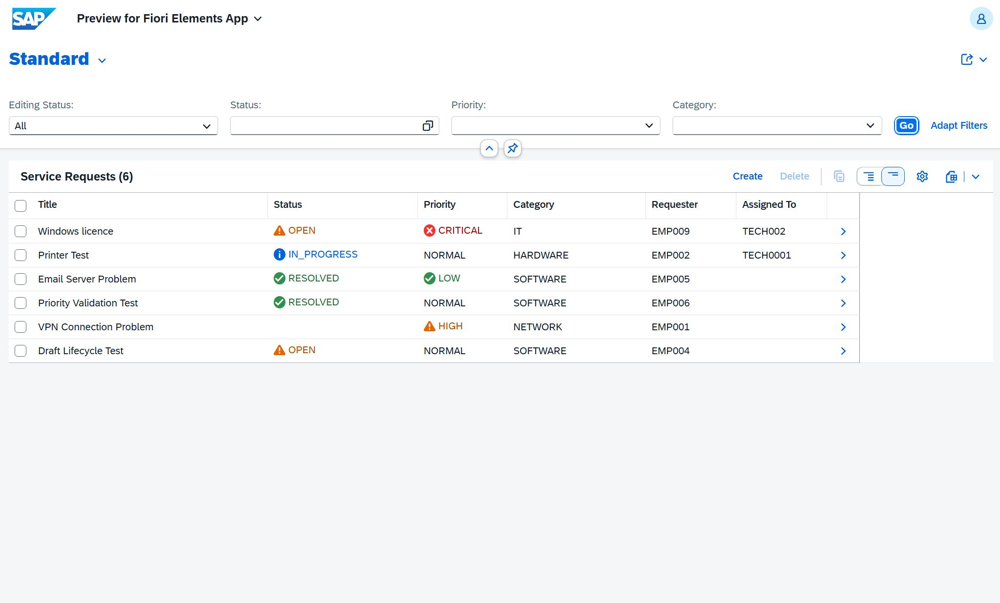
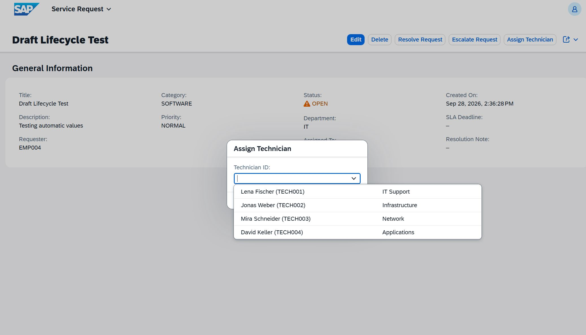
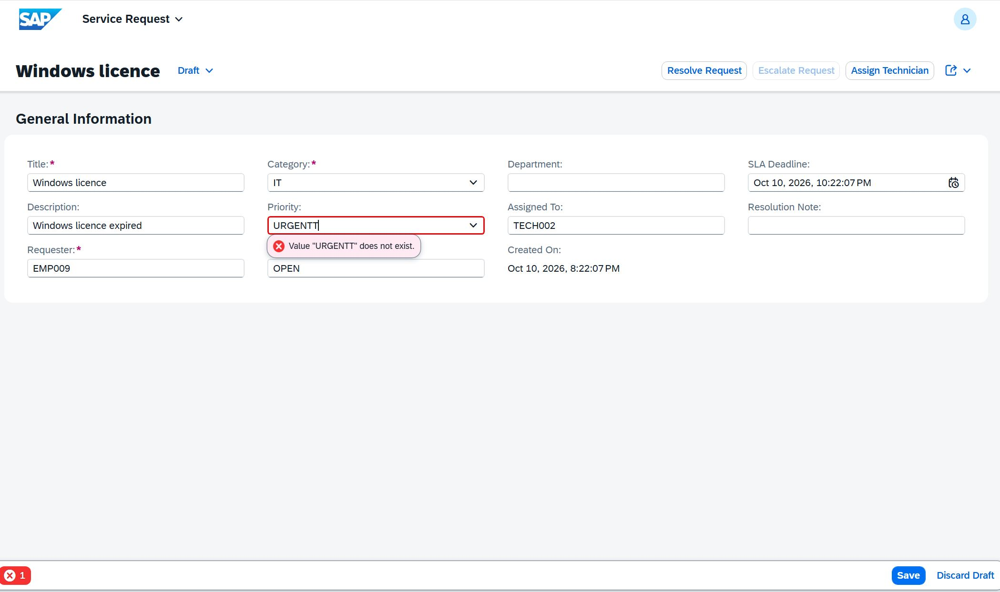

# SAP Smart Service Management

Ein Service-Management-System auf Basis von **SAP ABAP Cloud**, dem **RESTful ABAP Programming Model (RAP)** und **SAP Fiori Elements**.

Die Anwendung bildet einen einfachen internen IT-Support-Prozess ab. Service Requests können erstellt, priorisiert, einem Techniker zugewiesen, eskaliert und anschließend gelöst werden.

Das Projekt ist als persönliches Lern- und Portfolio-Projekt entstanden, um moderne SAP-Entwicklung praktisch umzusetzen und die einzelnen RAP-Schichten besser zu verstehen.

## Vorschau



---
### Techniker zuweisen

Über eine parametrisierte RAP Action kann ein Techniker ausgewählt und dem Service Request zugewiesen werden.



### Validierung

Ungültige Prioritäten werden durch eine RAP-Validierung im Backend abgefangen und direkt in Fiori als Fehlermeldung angezeigt.



## Überblick

Ein Mitarbeiter kann beispielsweise einen Service Request wie

> „VPN-Verbindung funktioniert nicht“

erstellen.

Beim Anlegen werden automatisch Standardwerte gesetzt. Danach kann der Request einem Techniker zugewiesen, bei Bedarf eskaliert und nach der Bearbeitung abgeschlossen werden.

Zusätzlich enthält die Anwendung:

- Draft Handling
- automatische SLA-Berechnung
- Validierungen
- eigene RAP Actions
- Dynamic Feature Control
- Value Helps
- semantische Farben in Fiori
- eine kleine analytische Auswertung

---

## Technologien

- SAP BTP ABAP Environment
- ABAP Cloud
- RESTful ABAP Programming Model (RAP)
- Core Data Services (CDS)
- Managed RAP Business Object
- Draft Handling
- Behavior Definitions
- Behavior Implementations
- Determinations
- Validations
- RAP Actions
- Parameterized Actions
- Dynamic Feature Control
- Virtual Elements
- CDS Value Helps
- OData V4
- SAP Fiori Elements
- Analytical CDS Views
- abapGit
- Git / GitHub

---

## Hauptfunktionen

### Service Requests

Ein Service Request enthält unter anderem:

- Titel
- Beschreibung
- Anforderer
- Abteilung
- Kategorie
- Priorität
- Status
- zugewiesener Techniker
- Erstellungszeitpunkt
- SLA Deadline
- Lösungszeitpunkt
- Lösungsnotiz

---

## Automatische Initialwerte

Beim Erstellen eines neuen Requests werden automatisch Standardwerte gesetzt:

```text
Status     = OPEN
Priorität  = NORMAL
Created At = aktueller Zeitstempel
